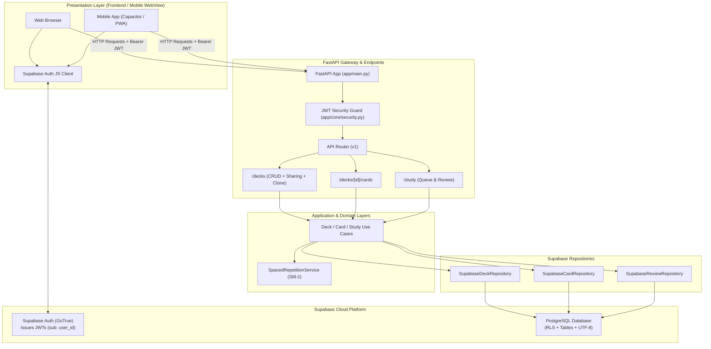
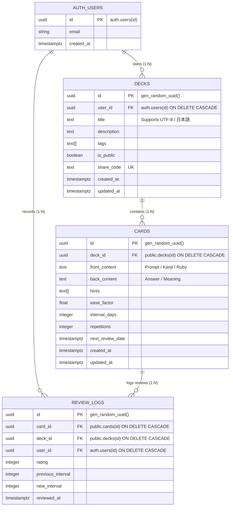
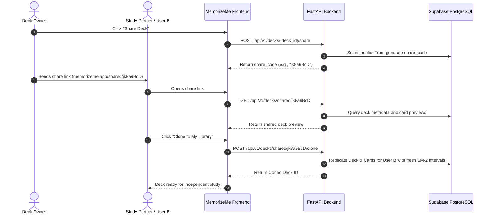

<div align="center">
  
  <br />
  <p>
    <strong>Active Recall &bull; Spaced Repetition &bull; Multi-Language &bull; Supabase &bull; FastAPI</strong>
  </p>
  <p>
    
    
    
    
    
  </p>
</div>

<br />

> An intelligent, extensible, and flexible flashcard system designed for active recall, spaced repetition, deck sharing, and international language learning (including Japanese / CJK). Powered by **FastAPI**, **Supabase (PostgreSQL)**, and **Supabase Auth**.

---

## 📌 Table of Contents
- [1. Overview](#1-overview)
- [2. Core Features](#2-core-features)
- [3. System Architecture](#3-system-architecture)
  - [3.1. Design Principles](#31-design-principles)
  - [3.2. Layered View (Clean Architecture / DDD)](#32-layered-view-clean-architecture--ddd)
  - [3.3. Architecture Diagram](#33-architecture-diagram)
- [4. Authentication & Security (Supabase Auth)](#4-authentication--security-supabase-auth)
- [5. Relational Database Architecture (Supabase PostgreSQL)](#5-relational-database-architecture-supabase-postgresql)
  - [5.1. Relational Design & Guarantees](#51-relational-design--guarantees)
  - [5.2. Entity Relationship Model](#52-entity-relationship-model)
  - [5.3. Row Level Security (RLS)](#53-row-level-security-rls)
- [6. Deck Sharing & Community Collaboration](#6-deck-sharing--community-collaboration)
- [7. Full Unicode & Multilingual Support (Japanese / CJK)](#7-full-unicode--multilingual-support-japanese--cjk)
- [8. Frontend Strategy (Mobile-First & WebView-Ready)](#8-frontend-strategy-mobile-first--webview-ready)
- [9. Backend (Python + FastAPI)](#9-backend-python--fastapi)
  - [9.1. Directory Structure & Responsibilities](#91-directory-structure--responsibilities)
  - [9.2. API Endpoints](#92-api-endpoints)
  - [9.3. Running the Backend](#93-running-the-backend)
- [10. Study Engine (Spaced Repetition)](#10-study-engine-spaced-repetition)
- [11. Infrastructure & Deployment](#11-infrastructure--deployment)
- [12. Technical Roadmap & Decisions](#12-technical-roadmap--decisions)

---

## 1. Overview

**MemorizeMe** is an active learning platform built around **Spaced Repetition** and **Active Recall** principles. Users can organize their knowledge into decks, craft multimedia flashcards, share decks with friends or the community, and run daily review sessions with automated retention tracking.

The system relies on **Supabase** for its managed **PostgreSQL database**, **Row Level Security (RLS)**, and **Supabase Auth**, offering enterprise-grade security and full UTF-8 Unicode support (including Japanese, CJK, and complex scripts).

---

## 2. Core Features

### 🔐 Authentication & Multi-Tenancy (Supabase Auth)
- Built-in user authentication via email/password, magic links, or OAuth (Google, GitHub, Apple).
- Stateless JWT verification on FastAPI endpoints.
- Database-enforced Row Level Security (RLS) preventing cross-tenant data leaks.

### 📂 Deck Management & Sharing
- **Creation & Editing**: Title, description, categories, tags, and visibility (private/public).
- **Deck Sharing**: Generate unique public share codes (`/shared/{share_code}`) or publish decks to the community catalog.
- **Deck Cloning / Forking**: Users can clone any shared deck into their personal account with an independent review schedule (resetting intervals while preserving content).
- **Deck Analytics**: Total card counts, cards due today, and historical retention rate.

### 🃏 Flashcard Management
- **Flexible Content**:
  - **Front (Prompt/Question)**: Text, Markdown formatting, Furigana ruby annotations, code snippets, and images.
  - **Back (Answer/Explanation)**: In-depth explanations, mnemonics, pitch accent, and progressive hints.
- **Metadata**: Ease factor, repetition count, interval length, and next scheduled review date.

### 🌐 Native Unicode & Language Learning
- Full UTF-8 end-to-end pipeline across database, API, and UI.
- Support for Japanese Furigana readings (`<ruby>日本語<rt>にほんご</rt></ruby>`).
- IME (Input Method Editor) safe typing detection to prevent premature card flip during character composition.

### 🎓 Study Mode
- **Smart Queue**: Computes and serves only cards due for review on the current date + configured new cards per day.
- **Interactive Feedback**: Users rate their recall during each card review:
  - `Blackout / Forgot` (Reset repetition cycle)
  - `Hard` (Short interval)
  - `Good` (Standard interval multiplication)
  - `Easy` (Accelerated interval with ease bonus)
- **Session Summary**: End-of-session report displaying cards reviewed, time spent, and accuracy.

---

## 3. System Architecture

To guarantee flexibility and long-term maintainability, the system is designed using **Clean Architecture** and **Domain-Driven Design (DDD)**.

### 3.1. Design Principles
- **Domain Independence**: Core business logic of MemorizeMe (such as the spaced repetition scheduling engine) does not depend on FastAPI or Supabase SDKs.
- **Repository Pattern**: Database persistence is abstracted through interface contracts (`IDeckRepository`, `ICardRepository`), allowing painless unit testing with mocks.
- **Defense in Depth**: Access control is verified at both application layer (FastAPI dependencies) and database layer (PostgreSQL Row Level Security policies).

### 3.2. Layered View (Clean Architecture / DDD)

```
┌────────────────────────────────────────────────────────┐
│               Presentation Layer (UI / API)            │
│   Responsive Web / Mobile App (WebView) / FastAPI      │
└───────────────────────────┬────────────────────────────┘
                            │
┌───────────────────────────▼────────────────────────────┐
│              Application Layer (Use Cases)             │
│  - DeckUseCases        - CardUseCases                  │
│  - StudyUseCases       - Pydantic DTOs & Schemas       │
└───────────────────────────┬────────────────────────────┘
                            │
┌───────────────────────────▼────────────────────────────┐
│                  Domain Layer (Core)                   │
│  - Business Entities (Deck, Flashcard, ReviewLog)      │
│  - Spaced Repetition Service (SM-2 Algorithm)          │
│  - Repository Interfaces (IDeckRepo, ICardRepo)        │
└───────────────────────────▲────────────────────────────┘
                            │
┌───────────────────────────┴────────────────────────────┐
│         Infrastructure Layer (Supabase Data & Auth)    │
│  - Supabase Python Client (PostgreSQL / PostgREST)     │
│  - Supabase Auth (JWT Bearer Token Validation)         │
│  - Database Row Level Security (RLS)                   │
└────────────────────────────────────────────────────────┘
```

### 3.3. Architecture Diagram



---

## 4. Authentication & Security (Supabase Auth)

The system delegates identity management to **Supabase Auth**:

1. **Client-side Authentication**: The frontend logs in using the Supabase JavaScript/TypeScript SDK:
   ```javascript
   import { createClient } from '@supabase/supabase-js';
   const supabase = createClient(SUPABASE_URL, SUPABASE_ANON_KEY);

   const { data, error } = await supabase.auth.signInWithPassword({
     email: 'user@example.com',
     password: 'secretpassword',
   });
   // JWT Access Token: data.session.access_token
   ```
2. **Authorized API Calls**: The client attaches the token in the `Authorization` header:
   ```http
   GET /api/v1/decks HTTP/1.1
   Authorization: Bearer <access_token>
   ```
3. **Token Verification**: FastAPI's `get_current_user_id` dependency decrypts and validates the JWT against `SUPABASE_JWT_SECRET`, extracting the authenticated user's UUID (`sub`).

---

## 5. Relational Database Architecture (Supabase PostgreSQL)

**MemorizeMe** leverages a relational model powered by **PostgreSQL 15+** via Supabase. The complete relational DDL script, foreign keys, indexes, and RLS policies are located in [`backend/supabase_schema.sql`](file:///c:/git/memorizeme/backend/supabase_schema.sql).

### 5.1. Relational Design & Guarantees
- **Strict Referential Integrity**: Foreign keys (`user_id -> auth.users.id`, `deck_id -> decks.id`, `card_id -> cards.id`) with `ON DELETE CASCADE` ensure that removing a deck or user automatically and cleanly purges associated flashcards and historical review logs without leaving orphaned data.
- **Normalized Schema**: Eliminates content duplication between decks and review logs, making analytics and aggregation queries (such as mastery curves and retention rates) efficient.
- **ACID Transactions**: Guarantees consistency when processing card reviews: logging the review and updating card intervals occur within transactional bounds.
- **Optimized Relational Indexes**:
  - `idx_cards_study_due` on `(deck_id, next_review_date)`: Accelerates the daily study queue query so it executes in logarithmic time $O(\log n)$.
  - `idx_decks_share_code` on `(share_code)`: Enables instant $O(1)$ lookups for shared links.
  - Partial index `idx_decks_is_public` on `(is_public) WHERE is_public = TRUE`: Keeps the community discovery index compact and fast.

### 5.2. Entity Relationship Model



### 5.3. Row Level Security (RLS)
PostgreSQL policies enforce multi-tenant isolation and access control directly at the SQL engine level using relational subqueries:
- **Private Decks**: Only accessible if `auth.uid() = user_id`.
- **Public & Shared Decks**: Discoverable if `is_public = true` or matching a valid `share_code`.
- **Cards**: Modifiable only by the owner of the parent deck via relational existence check:
  ```sql
  EXISTS (SELECT 1 FROM public.decks d WHERE d.id = cards.deck_id AND d.user_id = auth.uid())
  ```
- **Review Logs**: Read and inserted strictly by their owner (`auth.uid() = user_id`).

---

## 6. Deck Sharing & Community Collaboration

Sharing decks allows users to learn together and leverage curated community knowledge bases:



---

## 7. Full Unicode & Multilingual Support (Japanese / CJK)

To provide first-class support for Japanese (日本語), Chinese (中文), Korean (한국어), and other non-Latin scripts:

### 7.1. Database Layer (PostgreSQL)
- Database is created with `UTF8` character encoding.
- Text search and indexes support language-specific collation (`ja-JP`).

### 7.2. Frontend & Typography Guidelines
- **Furigana / Ruby Annotations**: Flashcard text supports HTML5 `<ruby>` elements:
  ```html
  <ruby>日本語<rt>にほんご</rt></ruby>を<ruby>勉強<rt>べんきょう</rt></ruby>する
  ```
- **IME Composition Safety**: In Japanese and East Asian languages, input uses an Input Method Editor (IME). When typing Roman letters to convert to Kanji, pressing `Enter` confirms character conversion. The UI checks `event.isComposing` to avoid submitting the card accidentally during character selection:
  ```javascript
  const handleKeyDown = (e) => {
    if (e.key === 'Enter' && !e.nativeEvent.isComposing) {
      revealOrSubmitCard();
    }
  };
  ```
- **Font Stack**: Fallback font definitions prioritize high-legibility CJK typography:
  ```css
  font-family: 'Inter', 'Noto Sans JP', 'Hiragino Kaku Gothic ProN', 'Meiryo', sans-serif;
  ```

---

## 8. Frontend Strategy (Mobile-First & WebView-Ready)

The frontend is architected as **Mobile-First, Framework-Agnostic, and WebView-Ready**, allowing direct compilation into iOS/Android apps via Capacitor or installation as a standalone PWA.

### 8.1. Directory Structure (`frontend/`)

The `frontend/` folder isolates business logic from UI frameworks, meaning you can plug in **React**, **Angular**, **Vue**, or **Svelte** without rewriting API calls, types, or utilities:

```text
frontend/
├── public/                      # Static assets & PWA manifest (display: standalone)
│   └── manifest.json            # PWA configuration for mobile installation
├── src/
│   ├── assets/
│   │   └── styles/
│   │       ├── safe-area.css    # Mobile notch, home-bar & touch padding variables
│   │       └── main.css         # Global reset, CJK typography, and 3D flip card styles
│   ├── core/                    # 100% Framework-Agnostic Core Logic (Pure TypeScript)
│   │   ├── api/                 # Typed API client connected to FastAPI backend
│   │   │   ├── client.ts        # Fetch client with auto Supabase JWT Bearer injection
│   │   │   ├── decks.api.ts     # Decks CRUD, sharing, public explore, and cloning
│   │   │   ├── cards.api.ts     # Flashcard CRUD endpoints
│   │   │   └── study.api.ts     # Study queue & review submission endpoints
│   │   ├── auth/                # Supabase Auth session & token manager
│   │   │   └── supabase.ts
│   │   ├── config/              # Environment configuration
│   │   │   └── env.ts
│   │   ├── types/               # TypeScript interfaces matching backend models
│   │   │   ├── deck.ts
│   │   │   ├── card.ts
│   │   │   └── study.ts
│   │   └── utils/
│   │       ├── gestures.ts      # Mobile touch swipe detector for study cards
│   │       └── ime.ts           # Japanese / CJK IME composition detection helper
│   ├── components/              # UI Component scaffolding (common, decks, cards, study)
│   └── views/                   # Application pages (auth, decks, study, explore)
├── index.html                   # HTML entrypoint with mobile viewport-fit=cover
├── .env.example                 # Environment variables template
└── README.md                    # Framework setup guide (React, Angular, Vue)
```

### 8.2. Key Capabilities & Ergonomics
- **Fluid Layout**: Developed primarily for mobile viewport dimensions (320px to 430px) and gracefully scaling to desktop with a centered "physical card" view.
- **Safe Area Insets**: Native notch, dynamic island, and gesture bar compliance:
  ```css
  padding-top: env(safe-area-inset-top);
  padding-bottom: env(safe-area-inset-bottom);
  ```
- **Overscroll & Bounce Prevention**: Eliminates accidental browser pull-to-refresh actions while dragging cards (`overscroll-behavior-y: contain`).
- **Touch & Gestures**: Generous touch targets (minimum **48x48px**), swipe gestures for rating cards, and tap-to-flip 3D card animations.
- **IME Composition Safety**: In Japanese/CJK, prevents premature card flip while selecting ideogram candidates (`isImeComposing`).
- **Offline Capability**: Local caching via IndexedDB/LocalStorage allows offline review sessions with background synchronization when reconnected.

---

## 9. Backend (Python + FastAPI)

### 9.1. Directory Structure & Responsibilities

```
backend/
├── app/
│   ├── main.py                     # API entrypoint, CORS setup, and lifespan handlers
│   ├── core/
│   │   ├── config.py               # Global settings (Pydantic BaseSettings)
│   │   └── security.py             # Supabase Auth JWT Bearer token validator
│   ├── domain/                     # Domain Layer (Pure Python, zero external dependencies)
│   │   ├── entities/               # Domain models (Deck, Flashcard, ReviewLog)
│   │   ├── interfaces/             # Abstract contracts (IDeckRepository, ICardRepository)
│   │   └── services/               # SM-2 Spaced Repetition Algorithm service
│   ├── application/                # Application Layer (Use cases and DTOs)
│   │   ├── dtos/                   # Pydantic input/output validation schemas
│   │   └── use_cases/              # Orchestration logic (Deck, Card, and Study use cases)
│   ├── infrastructure/             # Data Access & External Adapters
│   │   └── database/
│   │       ├── supabase_client.py  # Supabase client singleton
│   │       └── repositories/       # Supabase PostgreSQL repository implementations
│   └── presentation/               # HTTP Routing & Dependency Injection
│       └── api/v1/
│           ├── dependencies.py     # FastAPI dependency providers (Depends)
│           ├── router.py           # v1 Route aggregator
│           └── endpoints/          # REST Controllers (decks.py, cards.py, study.py)
├── supabase_schema.sql             # PostgreSQL schema with RLS and indexes
├── Dockerfile                      # Container build definition
├── requirements.txt                # Python dependencies (fastapi, uvicorn, supabase, pyjwt)
└── .env.example                    # Environment variable template
```

### 9.2. API Endpoints

| Method | Endpoint | Description |
| :--- | :--- | :--- |
| `GET` | `/api/v1/decks` | List authenticated user's decks |
| `POST` | `/api/v1/decks` | Create a new deck |
| `GET` | `/api/v1/decks/{deck_id}` | Retrieve deck details |
| `PATCH` | `/api/v1/decks/{deck_id}` | Update deck title, tags, or settings |
| `DELETE` | `/api/v1/decks/{deck_id}` | Remove deck and cascade delete cards |
| `POST` | `/api/v1/decks/{deck_id}/share` | Enable sharing & generate public share code |
| `GET` | `/api/v1/decks/public/explore` | Browse community public decks |
| `GET` | `/api/v1/decks/shared/{code}` | Preview a shared deck & card list |
| `POST` | `/api/v1/decks/shared/{code}/clone` | Clone a shared deck into personal library |
| `GET` | `/api/v1/decks/{id}/cards` | List flashcards belonging to a deck |
| `POST` | `/api/v1/decks/{id}/cards` | Add a new flashcard to a deck |
| `GET` | `/api/v1/study/decks/{id}/queue` | Fetch cards currently due for review |
| `POST` | `/api/v1/study/review` | Submit active recall rating and recalculate interval |
| `GET` | `/health` | Application health check |

### 9.3. Running the Backend

#### Step 1: Initialize Supabase Database
1. Create a project at [supabase.com](https://supabase.com).
2. Open the **SQL Editor** in the Supabase Dashboard and run the contents of [`backend/supabase_schema.sql`](file:///c:/git/memorizeme/backend/supabase_schema.sql).
3. Copy your project credentials from **Project Settings > API**:
   - `Project URL` -> `SUPABASE_URL`
   - `service_role` or `anon` key -> `SUPABASE_KEY`
   - `JWT Secret` -> `SUPABASE_JWT_SECRET`

#### Step 2: Configure Environment
Copy and populate `.env`:
```bash
cp backend/.env.example backend/.env
```

#### Step 3: Run with Python Virtualenv or Docker
```bash
cd backend
python -m venv .venv

# Windows:
.venv\Scripts\activate
# Linux/macOS:
source .venv/bin/activate

pip install -r requirements.txt
uvicorn app.main:app --reload --port 8000
```

---

## 10. Study Engine (Spaced Repetition)

The study loop is powered by the **MemorizeMe Spaced Repetition Engine** (SM-2 based):

1. **Daily Study Queue**:
   $$\text{Eligible Cards} = \{ c \in \text{Flashcards} \mid c.\text{nextReviewDate} \le \text{Now} \}$$

2. **Recall Scoring & Rescheduling**:
   - `0 (Blackout)`: Card failed completely. Repetition counter resets to 0; interval resets to 1 day.
   - `2 (Hard)`: Correct with significant recall effort. Reduced ease factor and modest interval.
   - `3 (Good)`: Correct with moderate effort. Standard interval growth ($I_{n} = I_{n-1} \times EF$).
   - `4 (Easy)`: Immediate recall. Ease factor increased with accelerated interval jump.

---

## 11. Infrastructure & Deployment

- **Database & Auth**: Managed by **Supabase** (PostgreSQL 15+, automated backups, real-time replication, and JWT auth).
- **Backend API**: Containerized via `Dockerfile`, ready for deployment on Render, Railway, Fly.io, or Google Cloud Run.
- **Frontend Hosting**: Vercel, Netlify, or Cloudflare Pages.

---

## 12. Technical Roadmap & Decisions

- [x] **Base Architecture**: Clean Architecture with decoupled Domain-Driven Design (DDD).
- [x] **Backend Framework**: Python 3.11+ with FastAPI and Uvicorn.
- [x] **Database Engine**: Relational PostgreSQL 15+ (hosted on Supabase) with Row Level Security & full UTF-8 Unicode.
- [x] **Authentication**: Supabase Auth (JWT Bearer Token validation).
- [x] **Database Schema**: Complete SQL migration with RLS policies in `backend/supabase_schema.sql`.
- [x] **Deck Sharing & Cloning**: Implemented via share codes and independent replication.
- [x] **Multilingual Support**: Unicode & Japanese IME / Furigana specifications integrated.
- [ ] **Responsive Frontend Stack**: (Recommended: React + Vite / Next.js with Tailwind CSS).
- [ ] **Mobile Wrapper**: (Capacitor for compiling to iOS App Store / Google Play).
